  <!-- Bespoke Developer Header Banner -->
  

    

  <!-- Animated Terminal Typing Headline -->
  

   

  <!-- Status & Quick Badges -->
  

    
    
    
    
  

  <!-- Social & Quick Action Badges (Cohesive Dark Theme) -->
  

    
    
    
    
    
  

---

### ⚡ About Me

  I am a backend and cloud-oriented software engineer based in Yogyakarta, Indonesia. Recently graduated with a <b>Bachelor of Informatics</b> from <b>Universitas Ahmad Dahlan</b> (<b>GPA 3.91 / 4.00</b>, completed in 3.5 years) and an alumnus of the <b>Bangkit Academy 2024</b> Cloud Computing cohort led by Google, GoTo, and Traveloka.

  During my studies, I spent two years as a <b>Teaching Assistant</b> for foundational computer science courses (Programming Algorithms, Informatics Logic, and Operating Systems) while designing and implementing production backends, RESTful APIs, and cloud-native deployments.

 

<table width="100%">
  <thead>
    <tr>
      <th width="25%" align="center">🎓 Academic Honor</th>
      <th width="25%" align="center">☁️ Cloud Training</th>
      <th width="25%" align="center">👨‍🏫 Mentorship</th>
      <th width="25%" align="center">📍 Availability</th>
    </tr>
  </thead>
  <tbody>
    <tr>
      <td align="center">
        <b>GPA 3.91 / 4.00</b> 
        UAD · 3.5-Year Fast Track
      </td>
      <td align="center">
        <b>Bangkit Academy 2024</b> 
        Google Cloud Cohort
      </td>
      <td align="center">
        <b>Teaching Assistant</b> 
        Informatics Lab (2 Years)
      </td>
      <td align="center">
        <b>Yogyakarta, Indonesia</b> 
        Open to Remote & On-Site
      </td>
    </tr>
  </tbody>
</table>

 

#### 🎯 Core Engineering Focus

- **Backend Architecture & Scalable APIs:** Building resilient, maintainable RESTful services and relational schemas using **Node.js (Express)** and **PHP (Laravel)**.
- **Cloud Infrastructure & Containers:** Provisioning, automating, and deploying containerized workloads using **Docker** and **Google Cloud Platform (GCP)** (Cloud Run, Cloud Storage, Compute Engine).
- **Production AI/ML Integration:** Bridging machine learning pipelines with high-throughput backend interfaces for reliable real-time inference (such as in *DermaScan*).

---

### 🛠️ Tech Stack & Tooling

| Domain | Technologies |
| :--- | :--- |
| **Languages** | `JavaScript` `TypeScript` `Python` `PHP` `C++` `SQL` `HTML5` `CSS3` |
| **Backend & Cloud** | `Node.js` `Express.js` `Laravel` `Google Cloud (GCP)` `Firebase` `Docker` |
| **Databases** | `PostgreSQL` `MySQL` `MongoDB` `SQLite` |
| **DevOps & Tools** | `Git` `GitHub` `Linux / Bash` `Postman` `Docker Engine` `VS Code` |

 

  

---

### 🚀 Featured Engineering Projects

| Project | Role | Core Stack | Description | Source / Demo |
| :--- | :---: | :---: | :--- | :---: |
| **DermaScan** | Backend & Cloud Lead | `Node.js` `Express` `GCP Cloud Run` `Cloud Storage` `TensorFlow` | Scalable cloud backend and inference APIs serving deep learning skin disease detection. Built as Bangkit 2024 Capstone. | [Capstone Project](#) |
| **Student Grade Management** | Full-Stack Developer | `PHP` `Laravel` `MySQL` `Tailwind CSS` | Academic grading portal for SMK Negeri 1 Lebong with granular role-based auth, student tracking, and analytical reports. | [Repository](https://github.com/agengwahid/sistem-nilai-smkn1-lebong) |
| **Kost Panjie Management** | Web Developer | `PHP` `Laravel` `MySQL` `Bootstrap` | Operational boarding house management system with resident occupancy monitoring, room billing, and financial ledgers. | [Repository](https://github.com/agengwahid/Kost-Profile-Quantum) |
| **Interactive Personal Portfolio** | Frontend Developer | `React` `Next.js` `Tailwind CSS` `Vercel` | Modern developer portfolio showcasing verified credentials, interactive timeline, and architecture case studies. | [Live Demo](https://porto-ageng.vercel.app/) |

---

### 📊 GitHub Activity & Insights

  <table border="0">
    <tr>
      <td align="center">
        
      </td>
      <td align="center">
        
      </td>
    </tr>
    <tr>
      <td colspan="2" align="center">
        
      </td>
    </tr>
  </table>

---

### 🏆 Key Certifications & Achievements

- 🥇 **Bangkit Academy 2024 — Cloud Computing Graduate** *(Google, GoTo, Traveloka)*
- ☁️ **Menjadi Google Cloud Engineer** *(Dicoding Indonesia)*
- ⚙️ **Belajar Membuat Aplikasi Back-End untuk Pemula dengan Google Cloud** *(Dicoding Indonesia)*
- 🤖 **Belajar Penerapan Machine Learning dengan Google Cloud** *(Dicoding Indonesia)*
- 🎓 **Lulusan Tepat Waktu (IPK 3.91 / 4.00)** *(Universitas Ahmad Dahlan · 3.5 Tahun)*
- 📜 **17+ Verified Professional Certificates** in Software Engineering, Cloud Architecture & Web Systems

---

### 📬 Get In Touch

  
I am actively exploring backend engineering and cloud architecture opportunities. Whether you have a project in mind, an open role, or just want to connect, feel free to reach out!

  

    
    &nbsp;
    
  

   

  

    Designed with focus on backend reliability &amp; clean cloud systems · © 2026 Muhammad Ageng Zayem Wahid
  

